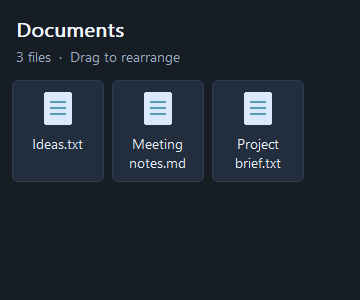
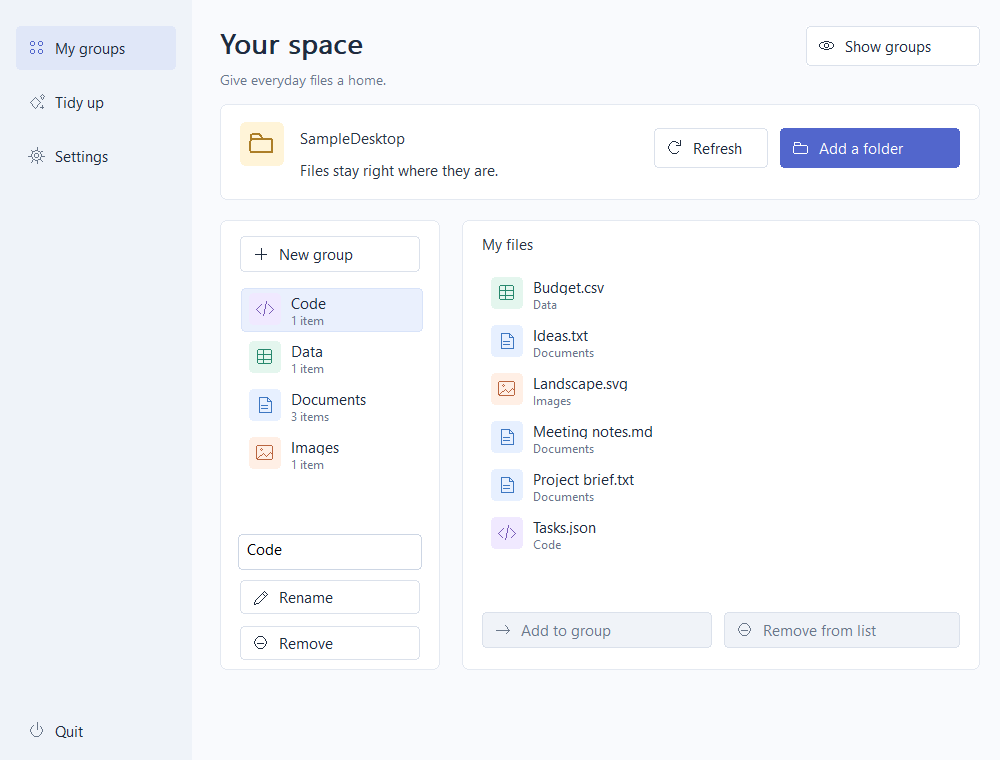
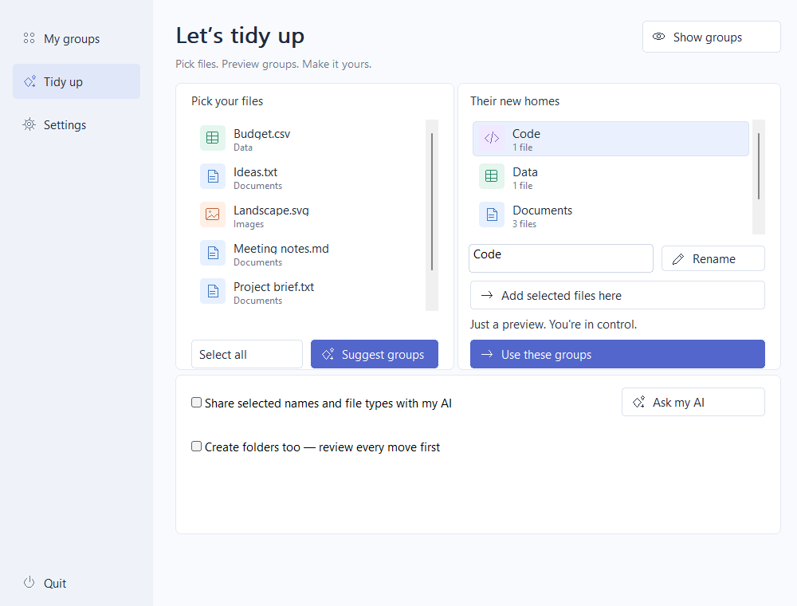
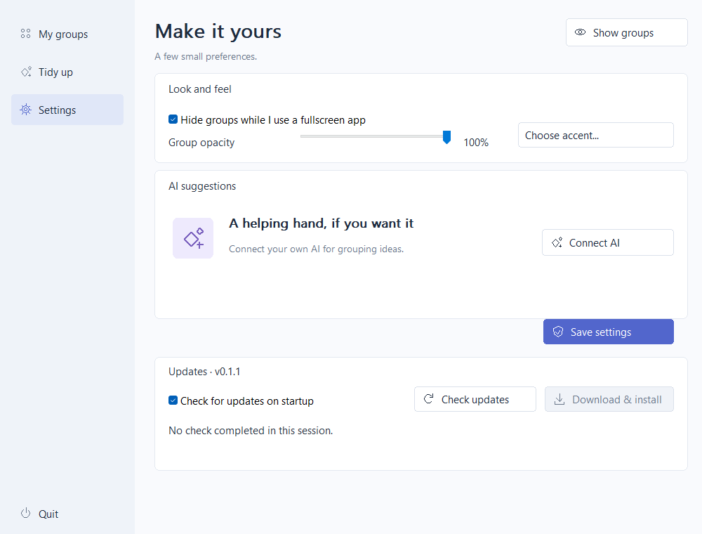
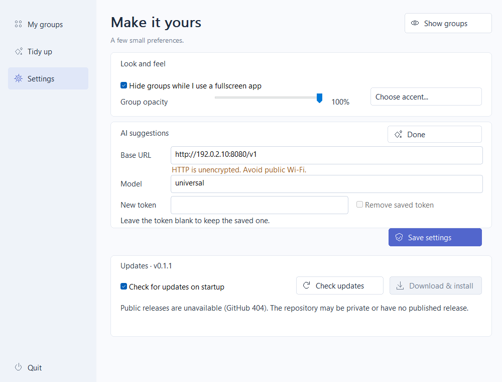
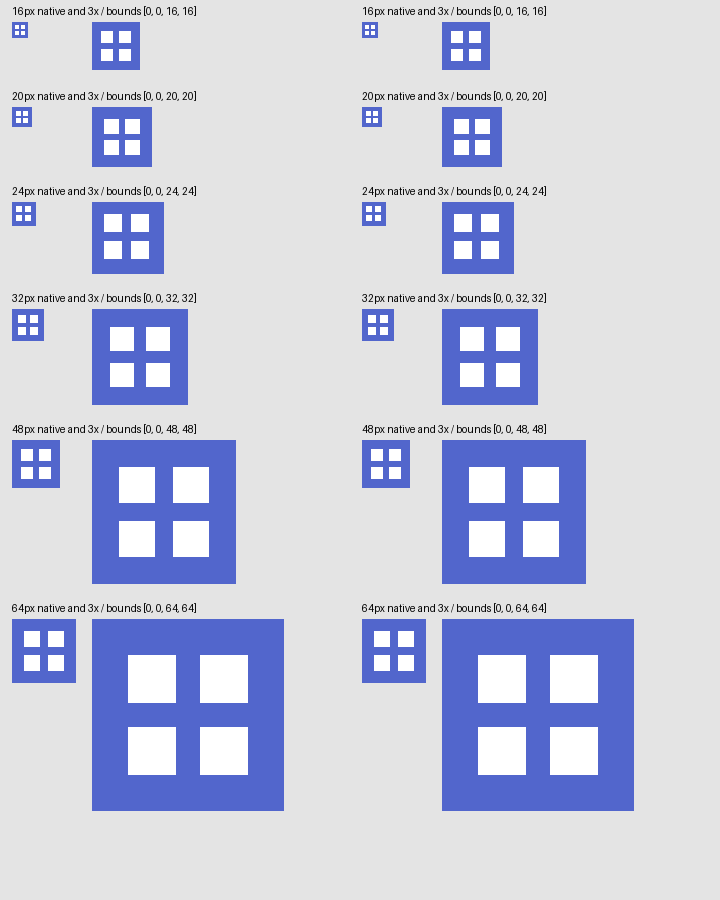

# DesktopOrganizer

An independent, MIT-licensed Windows desktop organizer with named groups and optional AI suggestions. It uses native Win32 controls and a custom GDI tile view. It has no connection to Stardock, uses no competitor code or artwork, and does not require WebView, a service, a model download or an AI subscription.

**Status: local implementation, v0.1.1.** Windows x64 compilation, 22 tests including synthetic HTTP exchanges, real component captures, and bounded native settings/navigation/idle/close/restore diagnostics are verified. Physical tray clicks, drag-and-drop and broader hardware behavior still need interactive validation. The planned [GitHub repository](https://github.com/siarheisinelnikau/desktop-organizer) and releases have not been published in this work session.

## What it does

- Named, movable, resizable group windows with persisted layouts, collapse/expand, mouse-wheel scrolling, opacity and an accent color.
- Import references from an explicitly selected folder, or drop files/folders from Explorer onto a group. Drag tiles between groups; double-click or press Enter to open an item. Delete removes a reference only.
- Tray entry for settings, show/hide groups and explicit save-and-quit; closing settings keeps the app in the tray. A second launch requests activation of the existing instance.
- Per-monitor DPI awareness, monitor-relative placement, clamping to the available work area after monitor changes, and optional hiding while the foreground window covers its monitor.
- Deterministic offline grouping by extension, item kind and type category; optional OpenAI-compatible metadata-only suggestions with a plain-language group preview supporting rename and file reassignment.
- Optional explicit filesystem organization: every move is previewed, constrained to the chosen source root, fingerprinted, journaled and undoable when original paths remain free and content remains unchanged.
- Manual and nonblocking startup update checks, a persistent startup opt-out, and user-initiated verified portable update installation with progress, backup, atomic replacement and restart.

Groups are ordinary **non-topmost tool windows**, independent of Explorer. This version does not embed them into the wallpaper layer, hide original Windows Desktop icons, or replace Explorer. Groups use original file glyphs rather than extracted Shell icons. Show Desktop is left to Windows; if it minimizes/hides the group windows, use **Show groups** in the tray/settings. Explorer's `TaskbarCreated` broadcast recreates the tray icon. These shell behaviors require the manual checks listed below.

## Build and package

Requires an existing Rust 1.95+ MSVC x64 toolchain and Windows SDK/linker; the validated toolchain is Rust 1.96.1. The target is Windows 10/11 x64. Older Windows and other executable architectures are unsupported. Runtime uses standard Windows APIs and a statically linked MSVC runtime; no application DLL bundle is needed.

```powershell
cd E:\work\github\desktop-organizer
# Once, when dependency downloading is permitted and they are not already cached:
cargo fetch --locked
./scripts/check.ps1
./scripts/package.ps1
# Optional static inspection with Python 3 (never loads/executes the EXE):
python scripts/inspect_binary.py dist/DesktopOrganizer-v0.1.1.exe
```

The shared updater workspace must be present at `../rust-auto-updator`; its core crate is a local path dependency, not a published package. CI runners must provision that sibling workspace before Cargo resolution. Standalone repository checkout is insufficient until the shared workspace is published or separately supplied.

Cargo uses at most two jobs and this repository's `target/`. Verification and packaging use `--offline` and never launch the GUI, updater helper, or any item. HTTP integration tests use a bounded server on `127.0.0.1` with synthetic tokens; no real AI provider is contacted. The output is `dist/DesktopOrganizer-v0.1.1.exe`, with `LICENSE`, `SHA256SUMS` and third-party license texts. This is one executable architecture, so its asset name has no architecture suffix. The binary is currently unsigned; no release or signing certificate is implied.

## Use

1. Start the EXE manually in a writable portable folder. No automatic Windows startup entry is installed.
2. In **My groups**, choose **Add a folder** to select and import a source folder in one step. Import is a snapshot; use **Refresh** for later changes. Refresh preserves existing group assignments and adds new references to the selected group. Missing files are not automatically removed.
3. Select a group to rename/remove it or add another. Select items and **Add to group**, or drag tiles between group windows. Double-click a group title or use its context menu to fold/unfold it. Closing a group folds it rather than deleting files.
4. In **Tidy up**, select files and choose **Suggest groups** for an offline preview. Rename a proposed group, or select files and use **Add selected files here**. **Use these groups** changes only the visual layout and keeps unselected references.
5. Optionally configure AI or use the separately enabled filesystem workflow described below.
6. In **Settings**, adjust the opacity slider (60–100%), accent or update preferences and choose **Save settings**. **Connect AI** reveals the optional provider fields. Use **Quit** to exit; the last layout write completes before normal exit.

Settings and references live in `%LOCALAPPDATA%\DesktopOrganizer\layout.json`; the current filesystem journal is `operation.json`. Layout writes use a flushed temporary file and atomic replacement. A malformed/future layout is preserved and startup reports an error instead of replacing it. An existing operation journal is reconciled in the file worker on startup so references follow verified completed moves; ambiguous states are reported for manual attention. Back up this directory while the app is closed if you need layout history. The first version has a single active layout, not multiple named layout profiles.

## Optional AI and privacy

Example for an independently configured ai-hub service:

```text
Base URL: http://localhost:8080/v1
Model: universal
New API token: <your own token>
```

Open **Settings → Connect AI**, enter the provider and your own token if required, and choose **Save settings**. A blank token field keeps the existing saved token; **Remove saved token** clears it. DPAPI encrypts the saved token for the current Windows user. Do not copy encrypted tokens between accounts. No provider secrets are included in this repository, read from other applications, or auto-discovered.

HTTP and HTTPS servers are supported, including an HTTP server on another LAN computer. HTTP displays **HTTP is unencrypted. Avoid public Wi-Fi.** under the address; it does not block saving or require another confirmation. Prefer HTTPS when the network cannot be trusted. DPAPI protects the saved token on disk, not an HTTP connection. API URLs must not embed credentials, queries or fragments.

Before each sharing session, select 1–200 items and explicitly enable **Share selected names and file types with my AI**. Only the selected names, extensions, kinds, categories and numeric IDs are sent by an explicit **Ask my AI** click. Filenames can contain private information; paths, file contents, icons and the rest of the imported library are not sent. Redirects are disabled so authorization is not forwarded elsewhere. Metadata consent is not persisted.

Responses must be strict JSON with only `groups`, `name` and `item_ids`. Unknown/duplicate IDs, missing items, empty groups, excess groups, extra fields, Markdown and oversized/malformed responses are rejected. Filenames are treated as untrusted data. No model text is executed as a command. A provider failure never silently applies a proposal; offline **Suggest groups** remains available. No live AI endpoint was called during development.

## Optional file moves and undo

Default grouping never moves files. To organize the filesystem deliberately:

1. Review the group preview and enable **Create folders too — review every move first**. This reveals the separate file-operation controls.
2. Choose **Review moves**. The scrollable pane lists every original path and final destination, including collision suffixes. Change group names or assignments in the group preview and preview again to change the plan.
3. Review all moves and choose **Move files**, then confirm the count. Changes to sources after preview cause a refusal, rather than moving unknown content.
4. **Undo moves** loads/reconciles the journal and reverses completed moves, including after a restart. Changed destinations or newly occupied original paths stop undo safely. Resolve such conflicts manually with the journal preserved, then retry.

Only ordinary files directly inside the chosen source folder can be moved into one-level group subfolders of that same root. Folders can be grouped visually but are not recursively moved. UNC/device paths, alternate data streams, traversal, symbolic links and reparse-point ancestors are rejected. Windows directory handles exclude write/delete sharing to prevent ancestor substitution; source content is verified through a handle locked against writers/deleters, followed by an atomic no-replace rename by handle. Collisions use numbered names in preview; new collisions after preview stop without overwriting. Cross-volume moves, cloud placeholders/reparse points and elevation are intentionally unsupported.

Journal entries are flushed before and after each rename. An interrupted operation with exactly one matching source/destination can be reconciled. Ambiguous cases (both/neither path, or edited content) require manual resolution; this is not a transactional rollback across all files. Earlier completed moves can be undone after a later move fails. Only empty directories recorded by the operation are removed during undo. A previous journal with completed moves must be undone/resolved before another file operation can replace it.

## Updates

**Check updates** uses the public stable release API for the canonical repository without GitHub login. **Check for updates on startup** is enabled by default; save this toggle to disable startup requests. Startup checks do not block launch, show intrusive failure/no-update dialogs, download or install automatically. Available updates remain visible in Settings. Missing/unpublished releases, rate limits and connectivity errors are reported as unavailable/error, not as up-to-date.

GitHub 404 is shown as **Public releases are unavailable**, with an explanation that the repository may be private or have no published release. This does not mean the installed version was confirmed current. On 2026-11-01 the connected GitHub plugin returned 404 for both the configured repository and its latest-release endpoint. No repository or release was created to hide that condition.

**Download & install** uses the shared `rust-auto-updator` core with this product's canonical repository/version/asset configuration. A release must include `DesktopOrganizer-vVERSION.exe` and `SHA256SUMS` for that exact asset. The core bounds the transfer, verifies SHA-256 and the x64 PE structure, stages beside the installed executable, and reports progress. Any GitHub-provided digest must agree with the checksum file. The application saves its layout before handing the verified update to the shared helper, and exits only after handoff succeeds. The helper waits for the original process, verifies its identity and unchanged installed bytes, atomically replaces the EXE with a backup, and restarts it. Settings and user files are never replaced.

Installation needs a writable EXE directory and no administrator rights. The shared staging folder uses `.desktop-organizer-update-` beside the executable; successful startup removes only known staged updater files. Preserve a failed staging folder/backup for investigation. A helper error is also recorded in `%LOCALAPPDATA%\DesktopOrganizer\update-error.txt`. No update download, helper launch or actual application replacement was executed during this audit.

## Verification and screenshots

See [verification](docs/VERIFICATION.md), [architecture](docs/ARCHITECTURE.md), and the [initial release-note draft](docs/RELEASE_NOTES.md). CI performs noninteractive Windows compilation and fixture tests, then uploads build artifacts; it never publishes a release.

The images below were generated by this executable from its production GDI renderer and native Win32 controls, using six synthetic files. They show client areas at 100% scale. They are not desktop photographs and do not certify OS-native tray menus or input behavior.











Reproduce these bounded render-save-exit captures with `./scripts/capture.ps1`. Each invocation renders its own components into a CPU bitmap, writes a PNG plus `.capture.json` metadata, and exits without tray registration, startup update requests or access to normal user settings. The script never automates the desktop.

Developer-only examples (use absolute output and fixture paths):

```powershell
./target/release/DesktopOrganizer.exe --capture E:/work/github/desktop-organizer/.local/review.png --screen settings --fixture-root E:/work/github/desktop-organizer/.local/SampleDesktop
./target/release/DesktopOrganizer.exe --capture E:/work/github/desktop-organizer/.local/empty.png --screen library --scenario empty
./target/release/DesktopOrganizer.exe --diagnose E:/work/github/desktop-organizer/.local/runtime.json --fixture-root E:/work/github/desktop-organizer/.local/SampleDesktop
```

Capture supports `library`, `organize`, `settings`, `group`, scenarios `populated`, `empty`, `error`, `long-names`, `ai-setup`, `http-server`, and scale 100/125/150. `http-server` is an explicit synthetic UI state, not a connection to the shown example address. Diagnostic mode verifies native saving of HTTP settings, a synthetic DPAPI token and the startup-check opt-out in its output directory. It also runs 30 native page transitions and finite visible/hidden/restore tests with five-second sampling windows, writes CPU and raster/layout counters, and exits; it can briefly show its own test windows. Apply an external timeout (15 seconds for capture, 35 for diagnosis). Physical tray activation, keyboard navigation, perceived flicker and presentation latency require separate interaction checks.


The Windows executable and native small tray handle now share embedded multi-size artwork. This is a resource rendering proof from the actual optimized EXE, not a screenshot of the OS tray:



The [verification record](docs/VERIFICATION.md) includes the v0.1.1 HTTP/settings checks and measured idle/hidden counters. [Icon resource metadata](docs/verification/icons-v0.1.1.json) identifies the current package; shell interaction limits remain separate from this resource proof.
